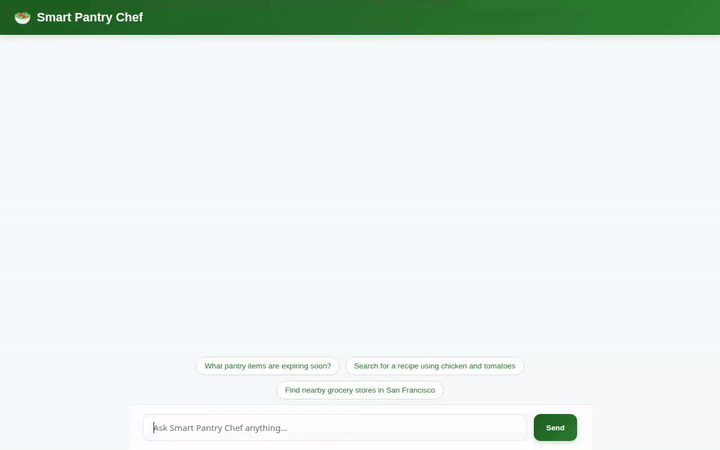

# Smart Pantry Chef Agent 🥗

Smart Pantry Chef is a conversational AI agent built with Google's **Agent Development Kit (ADK)** and deployed on **Vertex AI Agent Engine**. It helps users track pantry items, track upcoming expiration dates, search real recipe databases, find local grocery stores, generate dish visuals, and render interactive Adaptive UI (A2UI) cards while strictly respecting dietary restrictions across sessions.



---

## 🌟 Key Features & Implemented Tools

All features listed below are fully implemented and wired in `app/agent.py`:

* 📦 **Pantry Inventory Management**
  * `get_pantry_items`: Retrieves current stock from Cloud Firestore.
  * `add_pantry_item`: Adds new items with expiration dates to Firestore.
  * `get_expiring_pantry_items`: Identifies items expiring within a configurable window.
* 🍳 **Recipe Search & Discovery**
  * `search_online_recipes`: Queries TheMealDB API for real recipe ideas based on ingredients or dish names.
* 📍 **Location & Store Locator**
  * `geocode_address`: Resolves physical addresses into geographic coordinates using Google Geocoding API.
  * `find_nearby_places`: Searches for nearby grocery stores, bakeries, or supermarkets using Google Maps Places API.
* 🖼️ **AI Image & Video Visuals**
  * `generate_recipe_image`: Generates dish preview images using Vertex AI `gemini-3.1-flash-lite-image`, saved as ADK artifacts and uploaded to Cloud Storage.
  * `generate_recipe_video`: Generates short cooking videos using Vertex AI `gemini-omni-flash-preview` in the `global` region.
* 🧮 **Sandbox Code Execution**
  * `AgentEngineSandboxCodeExecutor`: Executes Python code safely for nutritional math and pantry data analysis in a remote sandbox environment.
* 🧠 **Cross-Session Memory**
  * `PreloadMemoryTool` & `VertexAiMemoryBankService`: Remembers dietary preferences, allergies, and user facts across sessions.
* 🎨 **Adaptive UI (A2UI)**
  * Renders lightweight structured UI component cards (`Card`, `Column`, `Row`, `Text`, `Image`) directly within the chat surface.

---

## ☁️ Integrated Google Cloud Services

* **Vertex AI Reasoning Engines (Agent Engine)**: Remote agent execution runtime.
* **Vertex AI Memory Bank**: Managed memory service for persistent facts and preferences.
* **Cloud Firestore**: NoSQL document store for `pantry_items`.
* **Cloud Storage**: Public asset storage bucket for generated images and videos.
* **Google Maps Platform**: Geocoding API and Places API (New) for location services.

---

## 🛠️ Local Setup & Running Instructions

### Prerequisites
* Python 3.11+
* `uv` package manager installed

### 1. Install Dependencies
```bash
uv pip install -r requirements.txt
uv pip install -r frontend/requirements.txt
```

### 2. Configure Environment Variables
Set the required API keys and configuration settings:
```bash
export GOOGLE_MAPS_API_KEY=YOUR_KEY_HERE
export MEALDB_API_KEY="1"
export AGENT_ENGINE_RESOURCE_NAME="projects/<PROJECT_ID>/locations/us-east1/reasoningEngines/<ENGINE_ID>"
export AGENT_DIRECTORY="app"
```

### 3. Run the Custom FastAPI Frontend
Start the local proxy and chat UI server:
```bash
cd frontend
uv run python main.py
```
Open your browser and navigate to `http://localhost:8080`.

### 4. Run via ADK Web CLI (Playground)
Alternatively, start the ADK Web dev UI:
```bash
uv run adk web . --port 8000 --reload_agents
```
